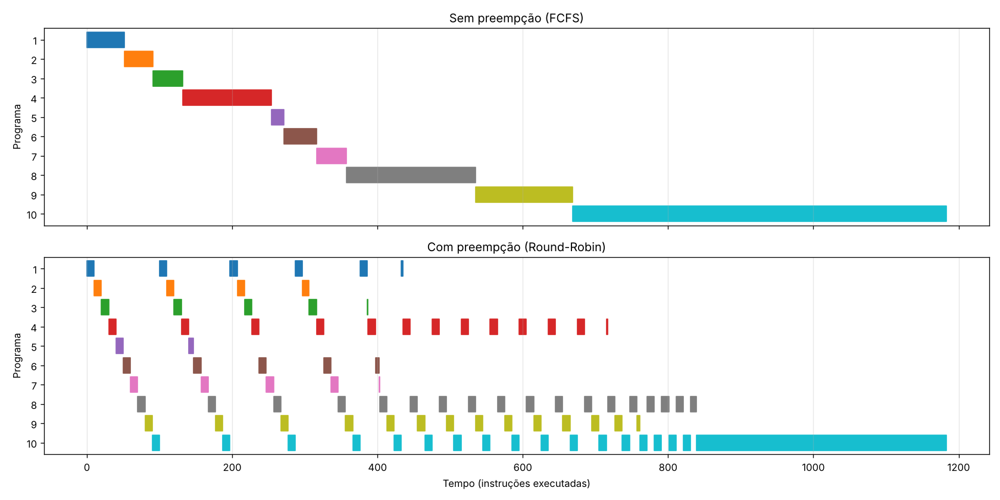

# Processador multiprogramado: execução sem e com preempção

Os 10 programas gerados pelo compilador ficam carregados ao mesmo tempo
no processador. Eles podem rodar de dois jeitos, escolhidos pela chave SW[17]
no momento do reset:

| Modo | SW[17] | Política | Quando o processo perde a CPU |
|---|---|---|---|
| Sem preempção | 0 | FCFS (lote) | só quando executa `HALT` |
| Com preempção | 1 | Round-Robin, quantum = 10 instruções | no `HALT` **ou** ao fim do quantum (interrupção de tempo) |

## Onde a mudança foi feita: processador ou compilador?

**No processador.** O compilador não muda nada, por três motivos:

1. **Preempção depende de hardware.** Quem tira a CPU de um programa no meio
   da execução é um temporizador (quantum), e o programa não sabe quando isso
   acontece. Se o compilador inserisse instruções de "ceder a vez" no código,
   o resultado seria escalonamento cooperativo, e não preempção.
2. **Relocação transparente.** Todo programa é compilado a partir do endereço 0
   (código e dados: `ldi $27,0`, `ldi $29,47`, saltos absolutos, endereço de
   retorno guardado na pilha). O hardware soma a base da partição de cada
   processo (registrador base/limite). Assim o mesmo binário funciona em
   qualquer partição, sem recompilar.
3. **Troca de contexto.** O PC e os registradores de cada processo precisam ser
   salvos e restaurados. Isso é papel do hardware/SO, não do programa.

O único passo "do lado do software" é colocar a saída do compilador em
`programas/progNN.txt` e rodar o script que monta a memória de instruções.

## O que foi acrescentado

| Arquivo | Função |
|---|---|
| `processadorSO_nucleo.v` | O processador em si, só com ligações entre blocos (é o "desenho" do BDF, ver `MONTAGEM_BDF.md`). Reaproveita o datapath monociclo (`teste_unidadeControle`, `ULA`, `extensorSinal`, `mux_*`, `somadorUm`, `teste_mux_jump_TESTE`, displays) |
| `baseTempo_SO.v` | Gera o `tick`: uma instrução a cada N ciclos de 50 MHz (substitui o `temporizador`) |
| `controleExecucao_SO.v` | Reset, modo, espera do IN, fim de processo e habilitações de escrita |
| `saidaOUT_SO.v` | Guarda os OUTs, o resultado de cada programa e as trocas de contexto, e escolhe o que vai para os displays |
| `leds_SO.v` | Monta os barramentos de LEDs |
| `processadorSO_multiprog.v` | Top-level para a placa DE2-115 |
| `processadorSO_sim.v` | Top-level para a waveform do Quartus: clock acelerado e sinais internos como pinos |
| `escalonador_SO.v` | Tabela de processos (PCB com o PC salvo e o estado finalizado). FCFS ou Round-Robin. Salva e restaura o PC na troca de contexto |
| `bancoRegistradores_SO.v` | 32 registradores **por processo**: o contexto dos registradores fica preservado enquanto o processo está fora da CPU |
| `memInstrucao_SO.v` | **Gerado.** Uma partição de 128 instruções por programa. Endereço físico = `{processo, PC lógico}` |
| `memoriaDados_SO.v` | Uma partição de 128 palavras por programa (base/limite). Um acesso fora da partição encerra o processo (como uma falha de segmentação) |
| `programas/prog01..10.txt` | Os 10 programas, no formato que o compilador gera |
| `ferramentas/gera_memInstrucao.py` | Gera `memInstrucao_SO.v` a partir de `programas/` |
| `tb_processadorSO.v` | Testbench: roda os dois modos e confere os resultados |
| `tb_waveform.v` | Testbench com os mesmos estímulos sugeridos para a waveform do Quartus |
| `ferramentas/gantt.py` | Desenha o diagrama de Gantt (`simulacao/gantt.png`) |

Os arquivos antigos (`testeComponentes.bdf`, `escalonador_RR*.v`, `PC_RR.v`
etc.) continuam no projeto, sem alterações. O `iZero.qsf` aponta para o novo
top-level `processadorSO_multiprog`. Para voltar ao processador de um programa
só, troque o `TOP_LEVEL_ENTITY` de volta para `testeComponentes`.

### Troca de contexto (Round-Robin)

No ciclo em que o processo executa a 10ª instrução do quantum:

1. `pcb[atual] <= PC seguinte` (salva o contexto).
2. O escalonador escolhe o próximo processo não finalizado, em ordem circular.
3. `PC <= pcb[próximo]` (restaura o contexto). Os registradores do próximo
   processo já estão no banco dele.

No `HALT`, o processo é marcado como finalizado e sai da fila. Quando todos
terminam, a CPU para.

### Entrada (IN)

Quando o processo atual executa um `IN`, a CPU espera o usuário (o LEDG[0]
acende). O display mostra qual programa está pedindo o valor. O tempo de espera
**não** consome o quantum, porque o quantum conta instruções executadas.

## Uso na placa (DE2-115)

As portas usam os nomes padrão da DE2-115 (`CLOCK_50`, `KEY`, `SW`, `HEX0..7`,
`LEDR`, `LEDG`). Para mapear os pinos, importe o arquivo de pinos da Terasic
(`DE2_115.qsf`) em *Assignments → Import Assignments*.

| Entrada | Função |
|---|---|
| KEY[0] | reset (o modo é lido de SW[17] neste momento) |
| KEY[1] | confirma o valor do `IN` |
| SW[8:0] | valor do `IN` |
| SW[16] | 0 = lento (cerca de 2 instr/s), 1 = rápido (cerca de 50 instr/s) |
| SW[17] | 0 = sem preempção, 1 = com preempção |
| SW[3:0] | depois que todos terminam, escolhe o programa cujo resultado é mostrado |

| Saída | Durante a execução | Depois que todos terminam |
|---|---|---|
| HEX7-6 | programa em execução | programa escolhido em SW[3:0] |
| HEX5-4 | programa que fez o último OUT | número de trocas de contexto |
| HEX3-0 | valor do último OUT | resultado do programa escolhido |
| LEDR[9:0] | programas finalizados | |
| LEDR[17:11] | PC lógico do programa atual | |
| LEDG[0..3] | aguardando IN / modo preemptivo / todos terminaram / houve falha de memória | |

## Simulação

```sh
python3 ferramentas/gera_memInstrucao.py          # só se mudar algum programa
iverilog -g2012 -o simulacao/tb.vvp -f simulacao/arquivos.txt
vvp simulacao/tb.vvp | tee simulacao/log.txt
python3 ferramentas/gantt.py                      # opcional, precisa de matplotlib
```

Para outro quantum: `iverilog -g2012 -Ptb_processadorSO.QUANTUM=5 ...`

### Resultado (quantum = 10, saída completa em `simulacao/log.txt`)

Os 10 programas dão o mesmo resultado nos dois modos. A tabela abaixo mostra
como o escalonamento muda. Os tempos são contados em instruções executadas.
Todos os programas chegam em t = 0.

| Proc | Programa | Instr. | Término FCFS | Término RR | 1ª vez na CPU FCFS | 1ª vez na CPU RR | Resultado |
|---|---|---|---|---|---|---|---|
| P1 | soma 3 entradas (5,7,9) | 52 | 52 | 458 | 0 | 0 | 21 |
| P2 | multiplicação (6,7) | 39 | 91 | 319 | 52 | 10 | 42 |
| P3 | área do triângulo (10,6) | 41 | 132 | 410 | 91 | 20 | 30 |
| P4 | mdc (48,18) | 122 | 254 | 740 | 132 | 30 | 6 |
| P5 | divisível por 3 (9) | 40 | 294 | 349 | 254 | 40 | 1 |
| P6 | subtração (20,8) | 45 | 339 | 425 | 294 | 50 | 12 |
| P7 | compara (3,8) | 41 | 380 | 426 | 339 | 60 | 1 |
| P8 | fatorial (6) | 178 | 558 | 862 | 380 | 70 | 720 |
| P9 | potência (2,5) | 134 | 692 | 784 | 558 | 80 | 32 |
| P10 | somatório (20) | 514 | 1206 | 1206 | 692 | 90 | 210 |

| Métrica | Sem preempção | Com preempção |
|---|---|---|
| Tempo total | 1206 | 1206 |
| Trocas de contexto | 9 | 91 (82 por quantum) |
| Turnaround médio | 399.8 | 597.9 |
| Espera média | 279.2 | 477.3 |
| Tempo de resposta médio | 279.2 | **45.0** |

Leitura: com todos os programas chegando juntos, o FCFS termina os processos
mais cedo em média (turnaround menor). O Round-Robin dá a CPU a todos logo no
começo (tempo de resposta cerca de 6 vezes menor), mas paga com mais trocas
de contexto e turnaround maior.

O testbench também foi rodado com quantum 1, 2, 3, 7, 25 e 1000. Com
quantum 1 há uma troca a cada instrução (869 trocas) e todos os resultados
continuam corretos, o que mostra que o contexto é preservado.



## Simulação na waveform do Quartus

A waveform do Quartus (*University Program VWF*) só mostra os pinos do
top-level, e na placa cada instrução dura 25 milhões de ciclos. Por isso existe
o top-level `processadorSO_sim`. Ele executa uma instrução a cada 2 ciclos de
clock e expõe como pinos os sinais internos que interessam.

### 1. Trocar o top-level e compilar

1. *Assignments → Settings → General → Top-level entity*: `processadorSO_sim`
   (ou clique com o botão direito em `processadorSO_sim.v` no *Project
   Navigator → Files* e escolha *Set as Top-Level Entity*).
2. *Processing → Start → Start Analysis & Synthesis* (Ctrl+K).

### 2. Criar a waveform

1. *File → New → University Program VWF*.
2. *Edit → Set End Time*: **50 us**.
3. *Edit → Insert → Insert Node or Bus → Node Finder*. Use o filtro
   **Pins: all**, clique em *List*, passe tudo para a direita (`>>`) e dê OK.
4. Desenhe as entradas (selecione o sinal e use os botões da barra):

| Entrada | Valor |
|---|---|
| `clock` | *Overwrite Clock*: período **20 ns** |
| `reset` | 1 de 0 a 100 ns, depois 0 (selecione o trecho e use *Forcing High*/*Forcing Low*) |
| `modoPreemptivo` | constante: **0** = sem preempção, **1** = com preempção |
| `valorIN` | constante **3** (*Overwrite Value* com radix decimal): todo IN recebe 3 |
| `botaoIN` | *Overwrite Clock*: período **400 ns**. Funciona como um usuário apertando o botão sem parar; só tem efeito quando a CPU está esperando um IN |

5. Clique com o botão direito em `programa`, `programaOut`, `valorOut`,
   `trocas` e `quantum` → *Radix* → **Unsigned Decimal**. Para `pc`, use
   decimal também.
6. Salve (por exemplo `Waveform_sem_preempcao.vwf`) e rode
   *Simulation → Run Functional Simulation*.
7. Para o outro modo, salve uma cópia com `modoPreemptivo = 1`
   (`Waveform_com_preempcao.vwf`) e simule de novo.

Se a simulação reclamar do caminho do simulador, configure em
*Tools → Options → EDA Tool Options* a pasta do ModelSim/Questa instalada
junto com o Quartus.

### 3. O que observar

- **`programa`**: sem preempção, fica em 1 até o HALT, depois 2, 3, … 10.
  Com preempção, muda a cada 10 instruções (1, 2, 3, …, 10, 1, 2, …), pulando
  os que já terminaram.
- **`quantum`** conta de 0 a 9 e, na décima instrução, `preempcao` e
  `trocaContexto` dão um pulso. No modo sem preempção, `quantum` continua
  contando, mas é ignorado (não há pulso de `preempcao`).
- **`pc`**: na troca de contexto, o PC salta para onde o próximo programa
  tinha parado. Isso mostra o PC restaurado do PCB.
- **`aguardandoIN`** sobe quando um programa chega num IN. A CPU fica parada
  (`executa` = 0) até a próxima subida de `botaoIN`.
- **`finalizados`** liga um bit por programa que terminou. **`todosFinalizados`**
  sobe no fim.
- **`programaOut` / `valorOut`** mostram cada resultado assim que o programa
  faz OUT. Com todas as entradas = 3, os valores esperados são:

| Programa | 1 | 2 | 3 | 4 | 5 | 6 | 7 | 8 | 9 | 10 |
|---|---|---|---|---|---|---|---|---|---|---|
| Cálculo | 3+3+3 | 3×3 | 3×3/2 | mdc(3,3) | 3 é múltiplo de 3 | 3−3 | a = b | 3! | 3³ | 1+2+3 |
| `valorOut` | 9 | 9 | 4 | 3 | 1 | 0 | 3 | 6 | 27 | 6 |

Na simulação de referência (`tb_waveform.v`), todos terminam por volta de
**30 µs** sem preempção (9 trocas de contexto) e de **27 µs** com preempção
(67 trocas). Os OUTs saem na ordem 1, 2, …, 10 no primeiro modo e embaralhados
no segundo (2, 3, 5, 1, 6, 7, 4, 9, 8, 10). A diferença de tempo total entre os
modos vem quase toda da espera pelo `botaoIN` em cada IN, não da CPU.

Para conferir sem o Quartus:

```sh
iverilog -g2012 -o simulacao/tbw.vvp tb_waveform.v processadorSO_sim.v $(tail -n +2 simulacao/arquivos.txt)
vvp simulacao/tbw.vvp
```

Para voltar a gerar o arquivo da placa, troque o top-level de volta para
`processadorSO_multiprog`.

## Top-level em BDF

O passo a passo para montar o top-level como diagrama de blocos (`.bdf`),
com a ligação de cada porta, está em [`MONTAGEM_BDF.md`](MONTAGEM_BDF.md).

## Para adicionar ou trocar um programa

1. Compile normalmente (a partir do endereço 0) e salve a saída
   `mem[i] = 32'b...;` em `programas/progNN.txt`. A primeira linha de
   comentário vira o título.
2. Rode `python3 ferramentas/gera_memInstrucao.py`.
3. Ajuste `NUM_PROGS` se mudar a quantidade (máximo 16). Cada programa
   precisa caber em 128 instruções e 128 palavras de dados.
